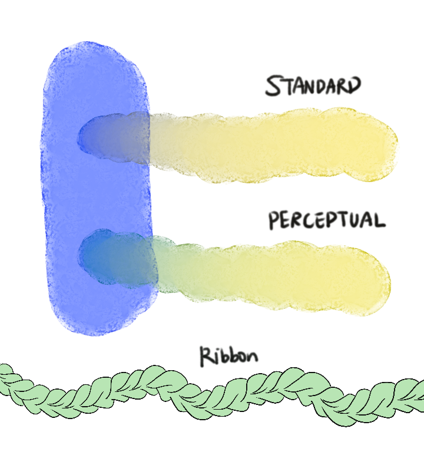
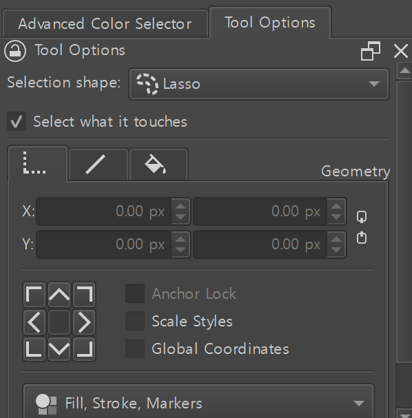

This is a custom build of Krita that adds many features from Clip Studio Paint (CSP) that are useful for comics! I built this for my own personal use and it will be maintained for as long as I use it. This project and I are not affiliated with the official Krita development team at all.

Please do **not** report problems with comicKrita to Krita's bug tracker; report them to this repository.

## Overview
This custom build adds the following:
* Ribbon brushes, as part of a rudimentary CSP-like brush engine
* Draw on vector layer with freehand brush with varying thickness
* Various vector line edit tools (like erase to crossings) based on above
* Small QoL UI/UX tweaks

See below for more details.

Video Demo:

## Freehand Vectors
* Create a **freehand vector layer** to start using it. Works with freehand brushes and vector line/shape tools. 
* Use **Select Shapes** for whole stroke edits and **Edit Shapes** for point-by-point edits.
* Each point has a thickness radius. in Edit shapes mode, you can select a point and ctrl+drag up or down to increase or reduce radius. Options in the Edit Shapes panel apply either on the whole layer (default if no selection) or on selected vector points. 
* You can change the brush preset with which the vector stroke is drawn using Edit Shape tool's "Brush" option. It always applies to the whole stroke. Note that it may not look the same as the real brush stroke b/c not all of the brush parameters is saved in vector.
* Use Vector Edit Tool for a brush-like area edit tool.
	* For thickness and opacity/density, pressing ctrl inverts the direction (e.g. thicken becomes thin, decrease opacity becomes increase opacity)
	* Trim is like CSP's vector eraser. You can erase whole strokes, only to crossings. or specific areas only.
		* Keep Caps preserves round caps, and won't be noticeable unless you use a polyline vector tool. Keep Fills likewise only works on polyline vector shapes (freehand brush strokes do not have a fill).
	* Smooth, Simplify, and Subdivide smooths points, simplifies strokes by removing/merging points, or adds points, respectively.

**IMPORTANT!!!** If you save the file you worked on with the custom build with stock Krita, the freehand vector format will be **DESTROYED**. The file can still be opened and edited, but the vectors will be flattened into stock vectors and will not work with the freehand vector tools.

* Limitations:
	* Only works with pixel and CSP brush engines.
	* Color mixing does not work on vector layers.
	* Does not support fills (stroke and fill will be the same color) or gradients. Caps also won't show up visually.
 	* There is only one liquify mode currently implemented (Move) for vectors. Behavior was tested using Move tool on Build-up mode, Amount and Spacing set to 0.01.

## CSP Paintop (including Ribbon Function)
* A CSP-like paint engine. Expect some rough edges; do NOT expect a 1:1 replication of CSP brush behaviors.
* Brush is slow at large sizes, especially with color mixing.
* Supports the following
	* CSP style pressure/tilt/speed curve, plus couple of Krita's like fade
	* Perceptual color mixing
	* Ribbon brush 
	* Dual color in image tips in greyscale
	* Color Jitter, Spraying Effect, Texture
	* Watercolor Edge
* You can use the python converter plugin (sut2kpp) to import sut brushes. Note that the converter was based on sut brushes exported from CSP v3. 
* **Only convert brushes you own or have permission to use.** Converting a brush does not change its license. Brushes made by other people stay under their creators' terms, and sharing converted copies may violate those terms. You are responsible for following the license of any brush you convert.

## UI/UX changes
* Setting to toggle snap to brush increment sizes without holding ctrl
* Setting to show the full reach of liquify brushes (stock Krita's falloff circle is smaller than the full effect area)
* Undo after one liquify dab doesn't undo size changes to liquify falloff. Liquify is also a little bit faster.
* Shape select can use ellipse, lasso, and polygon selection besides rectangle. You can also toggle to select shapes it touches (instead of encompasses).

 

## Using with Stock Krita

ComicKrita keeps its own settings file (`comickritarc`), its own shortcuts file and its own data folder (`comicKrita/krita` under the user's application data), and on Android its own package id. It can be installed and run beside an official Krita. The display settings file (`kritadisplayrc`) and the log files are still shared with Krita.

## Future planned features
* More UI/UX tweaks (e.g. temporary shortcut key, auto switch from transform to brush tool)
* Multibrush (symmetry) tool UI changes
* Comic panel folders, speed & focus lines
* Clipping layers, Brush previews

## Building

ComicKrita builds exactly like the Krita version it is based on; follow [Krita's build instructions](https://docs.krita.org/en/untranslatable_pages/building_krita.html). Its branding (`-DBRANDING=Comic`) is the default.

## Acknowledgements
Inspired by the approaches used in the following:
* [Blender Grease Pencil module (GPL-3.0)](https://projects.blender.org/blender/blender)
* [NijiGPen Grease Pencil Addon (GPL-3.0)](https://github.com/chsh2/nijiGPen)
* [CSP Brush extract (AGPL-3.0)](https://github.com/MorrowShore/CSPBrushExtract/tree/main)

And of course, many thanks to the Krita team!
